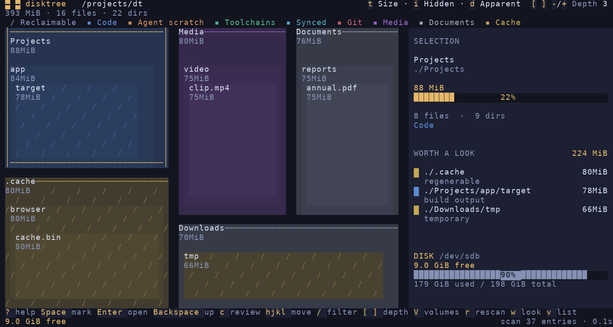

# disktree


Find what is filling a disk, mark what should go, and remove it — with the
volume's free space in view the whole time.

disktree is a treemap for Omarchy. Choose a local or SSH source, then a
mounted volume or directory; no scan starts until you explicitly accept.
It draws every directory as a nested mosaic sized by its real disk cost,
and lets you walk into it with the keyboard or the mouse. Mark as much as you
like; nothing happens until you review the list and commit, and the permanent
path always asks first.

Built with [GPUI](https://gpui-kit.com/) through
[gpui-omarchy](https://github.com/huacnlee/gpui-omarchy), so it follows your
Omarchy theme and behaves like the rest of the desktop.

## Install

Download `disktree-*-x86_64-linux.tar.gz` (`aarch64-linux` on ARM) from the
[latest release](https://github.com/tobi/disktree/releases/latest), unpack
it, and run `./install.sh` inside (or just copy `disktree` onto your
`PATH`). Or build it:

```sh
git clone https://github.com/tobi/disktree
cd disktree
make install
```

`make install` builds a release binary and puts three things under `~/.local`
(no root needed):

- `~/.local/bin/disktree`
- a desktop entry, so disktree is in the launcher and in a file manager's
  **Open with** for a directory (it adds a handler; it never becomes the
  default)
- an icon

`sudo make install PREFIX=/usr/local` installs system-wide; `make uninstall`
removes exactly what was installed.

On Arch, including Omarchy, disktree is in the AUR:
[`disktree`](https://aur.archlinux.org/packages/disktree) builds each release
from source, and
[`disktree-bin`](https://aur.archlinux.org/packages/disktree-bin) installs
the release binary:

```sh
yay -S disktree-bin
```

If another installed version wins on `PATH`, the installer warns which one.
Run `export PATH="$HOME/.local/bin:$PATH"` and add that setting to your shell
configuration so the locally installed build takes precedence.

For Linux builds with embedded SSH helpers, also install the two Rust
standard-library targets (no external C cross-compiler is needed):

```sh
rustup target add x86_64-unknown-linux-musl aarch64-unknown-linux-musl
```

You need Rust 1.97 or newer and a Wayland or X11 session with a GPU that GPUI
can drive (Vulkan). Distributions often package an older Rust;
[rustup](https://rustup.rs) installs a current one. The repo pins 1.97 in
`rust-toolchain.toml`, so with rustup the right toolchain is fetched on the
first build even if `rustup default` points at something older.

### Terminal

The terminal build runs without GPUI or a graphical session. From this
checkout, with Rust 1.97 or newer:

```sh
cargo install --locked --path crates/disktree-tui
```

See [In the terminal](#in-the-terminal) for its screen, controls, and
platform notes.

### macOS

Download `disktree-*-aarch64-macos.zip` (`x86_64-macos` for an Intel Mac)
from the [latest release](https://github.com/tobi/disktree/releases/latest),
unzip it, and drag `disktree.app` into Applications. macOS 11 or newer.

A release that was not signed and notarized is stopped by Gatekeeper: macOS
says it "is damaged and can't be opened" or "cannot be verified". The app is
fine; the browser marked the download as quarantined. Clear the mark once:

```sh
xattr -dr com.apple.quarantine /Applications/disktree.app
```

(Or open it once, then choose **Open Anyway** in System Settings › Privacy &
Security.)

Or build it, with Rust 1.97 or newer and Xcode or its Command Line Tools.
macOS does not come with Rust; install it with [rustup](https://rustup.rs).

```sh
make install     # ~/Applications/disktree.app, and ~/.local/bin/disktree
make uninstall
```

To see everything, give disktree **Full Disk Access** in System Settings ›
Privacy & Security (the panel offers a button when it is missing), then
reopen it. Without it macOS hides Mail, Messages, Safari, other apps' data
and the Trash, and disktree counts them as unreadable. Started from a
terminal, it is the terminal that needs the access. macOS also asks once
each for Desktop, Documents and Downloads.

What is different from Linux:

- **Free space** is what `df` reports. Finder's figure is larger: it counts
  purgeable space (caches and local snapshots macOS will clear on its own).
- **Cloned files** (copies APFS shares blocks between, as Finder's Duplicate
  makes) are each counted in full, so a total can exceed what deleting them
  frees.
- **Time Machine's local snapshots** are not files and do not appear; they
  are part of the gap between the scan and the disk's used space.
- **Cloud-only folders** (iCloud Drive, Dropbox and the like, evicted to the
  server) are not opened, so a scan never downloads them.

To sign and notarize a build for others, with a Developer ID certificate in
the keychain and credentials saved by `xcrun notarytool store-credentials`:

```sh
NOTARY_PROFILE=<profile> cargo xtask bundle \
  --sign "Developer ID Application: Name (TEAMID)" --notarize
```

### Windows

On Windows 10 or 11, download `disktree-*-x86_64-windows.zip`
(`aarch64-windows` on ARM) from the same release, unpack it anywhere and run
`disktree.exe`. Or build it with Rust 1.97 or newer, from
[rustup](https://rustup.rs), and the MSVC toolchain (Visual Studio Build
Tools, C++ workload):

```powershell
git clone https://github.com/tobi/disktree
cd disktree
cargo build --release    # target\release\disktree.exe
```

See [On Windows](#on-windows) for what differs there.

## Use

```sh
disktree            # choose a local/SSH source and root
disktree ~          # explicitly scan home
disktree --disk     # the whole disk it lives on
disktree ~/src      # or any directory
disktree --help     # options: apparent size, follow links, skip hidden, …
```

### Servers over SSH (read-only)

```sh
disktree ssh dev                 # connect and choose a remote root
disktree ssh user@server /var    # an explicit remote path
disktree ssh dev --disk          # the disk containing the remote home
disktree ssh dev -a /srv         # apparent size instead of allocated blocks
```

Linux builds made with `make build` / `cargo xtask portable` include static
**x86-64 and ARM64 Linux scanners appended to the executable**. SSH detects
the server's OS/CPU and uploads the matching scanner only when its checked
cache is missing or damaged. The cache is private and content-addressed under
`~/.cache/disktree/ssh/<sha256>/` (or the server's `XDG_CACHE_HOME`).
Uploads are checksum-verified and atomically installed; there is no sudo,
system-package change or dependency on the server's glibc version.

This uses stable Rust's musl targets rather than Cosmopolitan: the existing
Rust/rayon/rustix scanner has no supported stable Cosmopolitan target. These
are Linux binaries, not a single executable for every OS; ARM64 is built and
ELF-validated, while x86-64 was also executed against a real server.

You can extract a helper without opening a window, or test the entire
SSH/deployment/scan path headlessly:

```sh
disktree extract-scanner x86_64 ./disktree-scan
disktree extract-scanner aarch64 ./disktree-scan-arm64
disktree ssh dev --check /var/log
```

The appended manifest stores architecture, byte ranges and SHA-256 hashes.
Do not run `strip` after packaging: it discards the trailer. The Linux release
pipeline strips first, embeds last, and ships that single file. Appending to
signed macOS/Windows executables needs platform-specific signature handling;
those builds do not yet embed helpers.

For a development or non-Linux desktop build without the trailer, install
the small **disktree-scan** helper on the server first:

```sh
# On the server, inside the checkout:
make install-scan               # ~/.local/bin/disktree-scan; no GUI deps
# Or:
cargo install --path crates/disktree-scan --locked
```

The helper can be on the server's **non-interactive SSH PATH** or at
`~/.local/bin/disktree-scan` (the default install location); disktree tries
both. A binary copied from another machine must match the server's OS,
architecture and runtime. The manually built native helper may need the
server's libc; the embedded Linux helpers are static. Disktree never runs
sudo or changes the server's configuration.
SSH keeps your normal authentication settings. When launched from a
terminal, it can ask for a password or key passphrase there; GUI launches
need key/agent access or a working SSH askpass helper. Connect once with
`ssh dev` to verify access and accept its host key.

The protocol also supports lightweight root discovery, separate from a scan:
it reads the target's mount namespace without walking or probing the listed
paths. Same-device mounts remain distinct choices; capacity is unknown
until a root is explicitly selected. Discovery requests omit scan fields,
so outdated helpers reject them instead of silently scanning their home.

The Linux/macOS helper streams a depth-first walk directly to stdout. It
never constructs a tree or retains a directory's children: memory scales
with open ancestors, not file count. Deep directories are not rejected
at an arbitrary depth; filesystem errors are reported as unreadable.
Hardlink identities are sent to the desktop, which uses the local scanner's
compact identity index to count each inode once. The helper keeps no
per-file identity table in negotiated desktop-de-duplication mode; links
outside the chosen root cannot fill one. Older clients retain bounded
helper-side accounting for wire compatibility. A resource limit fails
explicitly instead of returning a partial tree. Symlinks are not followed,
and every nested mount is skipped, even a bind mount or same-device
subvolume. Select those as separate roots.

While indexing, a quiet sidebar shows live files, directories, measured
bytes, read errors and elapsed time. Counters and paths use monospace type
in fixed lanes; changing values do not re-center or reflow the screen.
Narrow windows use a compact progress footer instead.

Ordinary local walks and current SSH helpers paint a **live top-level
overview** before the full tree arrives. These are measured contributions,
not complete directory sizes. Updates are limited to once a second, in
arrival order, with at most 128 named buckets plus an overflow bucket. The
preview is kept separate from the real tree: it cannot be navigated,
marked or removed. On completion the full, actionable treemap replaces it;
on error or cancellation the preview is discarded. The Windows file-table
fast path still waits for its complete tree. Remote scans also show a
sampled recent directory and connection / helper setup / indexing / treemap
stages. Progress uses a single replaceable snapshot, not a growing event
queue; path updates are throttled to five per second. There is no guessed
percentage: the total is unknown until the walk finishes. Older helpers
still provide counters from their streamed records, without path samples.

One compressed SSH connection carries a bounded JSON request on stdin and
compact postorder records on stdout. The client keeps stdin open so the
helper exits on disconnect, including while scanning or blocked on output.
Linux helpers also enforce a 1 GiB address-space ceiling, disable core dumps,
and stop after five minutes. File contents never cross the connection and
paths are never interpolated into remote shell commands. Only the desktop
retains the complete tree for offline navigation; its memory still scales
with entry count. The native Windows helper currently retains the original
tree-building scan path.

Remote mode is **export-only**. Mark with Space, open review with `c`, then:

- **Copy as prompt** (`a`): includes the SSH host, remote OS, scan root,
  selected paths, sizes and cleanup precautions. It requires verifying the
  actual scanned hostname and machine ID before any destructive operation,
  and stopping if either check fails or cannot be performed.
- **Save list…** (`s`): remote paths, one per line, saved locally.
- **Copy delete script** (`y`), or **Save delete script…** (`e`): a
  GNU/Linux shell script, copied to the clipboard or saved locally.
  Running it without arguments only previews the selection. After reviewing
  it, `sh disktree-delete.sh --delete` connects to the named SSH host and
  runs the exported commands there, never against the local paths.

There are no trash/delete buttons or removal-mode choices in remote review.
Deletion shortcuts and removal entry points are disabled too. Git inspection,
local folder selection and file-manager reveal are disabled so remote names
cannot accidentally act on this computer. Free space is sampled when the
scan starts, **not live**; press `r` to refresh.

Before deleting, scripts compare the server's actual kernel hostname and
machine ID against the identity captured in the scan—not the SSH alias.
Missing identity or any mismatch aborts. The check runs on the SSH target,
not the computer launching the wrapper. Pasting the script previews it by
default and runs in a subshell, so its exit cannot close your terminal.

Exports are not an automatic cleanup recommendation. Scripts refuse system
paths, the scan root, home or its ancestors, symlinked/changed canonical paths,
and paths containing mount points. Control-character names are omitted.
These checks do not eliminate filesystem races or tell you whether git work
is backed up; review the script and prefer a tool's own cleanup command for
tool-owned data. The remote helper itself has no delete operation.

### The screen

- **Top:** the trail from `/`, then what is measured — **Size**, **Files** or
  **Age**, **Hidden files**, **Apparent size**, and the depth drawn. In the
  tree a crumb goes there, and its ▾ lists its siblings, largest first with
  their share and size, to jump sideways (arrows and Enter work too). Above
  the scanned root a crumb is dimmer, and clicking it widens the scan to
  there (see below).
- **Under it:** the scan totals, the filter when one is typed, and the legend.
- **Mosaic:** colour is the *kind* of data — code, agent scratch,
  toolchains, synced files, git, media, documents, caches — at one muted
  level, lighter with depth. A diagonal hatch is space that can be had back
  (caches, sync history, package stores, build output), independent of
  colour. Top-level directories carry a strip of their colour and a name
  band; deeper open directories a slim label row. In **Age** mode colour is
  the last write instead, from this week to older.
- **Panel:** the selection (its size set large, share of the scan, files,
  last write, and for a checkout what git says — changes, stashes, unpushed
  commits); *Worth a look*, the largest things that could plausibly go;
  what is marked; and the disk, free now and after the marks, with the way
  to the review screen. Drag its left edge to resize it; double-click the
  edge to reset.

One colour is kept apart: amber marks the selection, the main action, and
what can be had back.

The kinds come from directory names and a few shapes (a bare git repository,
`target` beside a `Cargo.toml`). Some of the names are specific to one
machine; see `crates/disktree-core/src/classify.rs`.

### Marking

Space, X, Enter and the arrows act on the tile under the mouse if the mouse
moved last, and on the keyboard selection after you use an arrow or Tab.

A marked tile takes the danger colour, and so does everything inside it:
removing a directory takes its contents with it. Marking a directory absorbs
any marks already inside it, and something inside a marked directory cannot be
marked or kept on its own; its panel offers to unmark the directory instead.
Marking is reversible — press it again — and the saving is never counted twice.

### Zooming and going in

Scroll to magnify toward the pointer. The wheel magnifies until the directory
under the pointer fills the view, and the next notch goes into it — one
continuous motion, with the directory's contents growing into place. Scroll the
other way to come back out. Enter goes into the selected directory at any
depth, and Backspace or Escape goes up one level. `<` and `>`, beside the
Size / Files / Age switch, go back and forward through the directories visited,
as do `alt ←` `alt →` (also `⌘[` `⌘]` on macOS) and the mouse's side
buttons. `+` and `-` magnify without going in; `0` resets.

### Removing

`c` (or **Review…**) opens the list of everything marked. Unmark anything
there, then choose:

- **Move to trash** — the default when a trash is available. On macOS that is
  the system Trash, the same move as Finder's (on another disk, that disk's
  own Trash; network shares often have none). Elsewhere it is `trash-put`
  from trash-cli, then `gio trash`, then a built-in XDG trash. Recoverable
  until the trash is emptied, so it commits directly.
- **Delete permanently** — `rm -rf` semantics. It always asks first, in a dialog
  that names what goes and how much comes back.

When it finishes, disktree scans again so the numbers on screen match the disk,
and shows how much free space was actually gained.

## Keys

| key | does |
| --- | --- |
| `space` / `x` | mark or unmark the tile you point at |
| `ctrl`-click (`⌘`-click on macOS) | mark without moving the selection |
| `enter` | open that directory, at any depth |
| `⌫` / `esc` | go up one directory |
| `alt ←` `alt →` | back and forward through where you have been |
| `←` `↑` `↓` `→` | move between tiles at this level |
| `tab` | next largest sibling |
| scroll | zoom toward a directory, then go into it |
| `shift`-scroll | pan the magnified view |
| `[` `]` | draw fewer or more levels at once |
| `-` `=` `0` | magnify, shrink, reset the view |
| `ctrl =` `ctrl -` `ctrl 0` (`⌘` on macOS) | interface zoom |
| `/` | filter by name: only matches keep their colour; `enter` shows only them, `esc` clears |
| `c` | review the marked list |
| `t` | size, files or age: what areas and colours say |
| `d` | disk usage or apparent size |
| `i` | include or skip hidden entries |
| `r` | scan again |
| `esc` while scanning | stop the scan |
| `v` | choose a local/SSH source and root |
| `ctrl o` (`⌘O` on macOS) | choose another directory to scan |
| `g` | the whole disk |
| `p` | show or hide the selection line |
| `o` | show it in Finder, File Explorer or the file manager |
| right-click | show that tile in Finder, File Explorer or the file manager |
| `?` | every key |
| `q` | quit |

On macOS the menu bar also has ⌘⇧R to show the selection in Finder, ⌘R to
rescan, ⌘[ and ⌘] for back and forward, and ⌘Q, ⌘H and ⌘W (closing the
window quits); other ⌘ chords are left to the system. On Linux and Windows
the same work with ctrl, with F5 to rescan too.

On the review screen: `m` trash, `p` permanent, `!` unmark all, `enter`
commits, `esc` goes back. Or hand the list on instead of acting on it: `s`
saves it as a text file, one path per line, and `a` copies a prompt for a
coding agent: free the space by removing what you picked, checking each path
first (git work that exists nowhere else, a tool's own clean command) and
touching nothing else. A name holding a newline is left out of the list and
escaped in the prompt, so it cannot pass for another path.

## What it measures

- **Disk usage** by default: `st_blocks × 512`, the number `du` reports and the
  space that actually comes back when a file is deleted. Apparent size (what
  `ls -l` shows) is one toggle away.
- **Hardlinks once.** Two names for one inode cost one file.
- **Hidden entries included**, because `~/.cache` is often the biggest thing in
  a home directory. Symlinks are not followed.
- **The projection counts one volume.** The meter shows the scanned volume's
  free space, so it adds up only the marks whose bytes come back to that
  volume, by the same rule the scan bounds the volume with. With `-X`, a mark
  on a disk mounted inside the tree, on a network share or in a snapshot
  subvolume is left out of the projection — removing it gives its space back
  somewhere else, or, in a snapshot, shares its blocks with the live files —
  and the panel and the review screen say what was left out. A mark whose
  volume cannot be told is not claimed either.

The scan follows [dust](https://github.com/bootandy/dust)'s approach: one rayon
scope per root, a completion counter per directory so no directory is built
before its last subdirectory lands, and one bottom-up pass that aggregates sizes
and removes duplicate hardlinks.

## Choosing sources and roots

Launch without a path to choose **This computer** or enter an SSH alias /
`user@host` and press **Connect SSH**. Discovery reads that machine's mount
namespace, not file contents. It never starts a scan or probes mounted
network filesystems just to fill the list.

Select a mount and choose **Scan selected root**, or enter an absolute
directory path and choose **Scan directory**. Enter acts on the focused
host/path field or the highlighted mount. Escape cancels discovery and
returns to the current scan, or the idle welcome screen at startup.

During exploration, press `v`, click **Source…** beside the disk name,
or click the disktree logo to reopen the same chooser. The source being
browsed is shown explicitly, and connecting never retargets an existing
scan. Changing machines on acceptance clears the old machine's marks,
identity and navigation history; an absolute path is not an identity
across hosts. A rescan that detects a changed or lost remote machine
identity also clears marks, even if the SSH alias is unchanged.

Pseudo-filesystems, snapshots and automount triggers are filtered out.
Linux bind mounts and btrfs subvolumes remain individually selectable,
even when they share a device. Free space is measured only after choosing
a root. Explicit command-line paths and `--disk` still start directly;
`ssh HOST --check [PATH]` remains the headless scan command.

## The whole disk

Click `/` (or any directory above the scanned root) in the trail, press
`g`, run `disktree --disk`, or use the launcher's *Scan the whole disk*
action. `g` and `--disk` scan the disk your home directory lives on — `/`
on Omarchy and on macOS. On macOS the Data volume's second mount,
`/System/Volumes/Data`, is skipped: it is `/Users`, `/Applications` and the
rest again under other names.

Widening is memoized: the tree already measured is handed to the wider walk
and reused where it is reached, so going from `~` to `/` reads only what is
outside `~` (on this machine, seconds instead of a full rescan). The current
view stays on screen until the wider tree lands, which then opens with the
directory you came from selected. Going back down is just navigation.

By default a scan stops at **every nested mount point**, including bind
mounts and same-device btrfs subvolumes. Boundaries are checked by path,
before metadata or directory reads, so an automounted NAS is not activated
just to measure its parent. Choose `/home`, `/var/log`, or another mount as
its own root rather than implicitly traversing it from `/`.

Local `-X` explicitly crosses mounts; remote streaming scans reject it.
A local mark on another volume is still removed, but is not added to the
metered volume's free-space projection.

Without root, some system directories cannot be read; they are counted as
unreadable in the top bar rather than guessed at.

## On Windows

The same program, with Windows' answers to the questions above:

- **Disk usage** is the allocation NTFS reports for each file: whole
  clusters, less for a compressed or sparse file, nothing for one small
  enough to live in its file record. It arrives with the directory listing
  itself (`FileIdExtdDirectoryInfo`), so it costs no more than the walk.
  Hardlinks count once on NTFS.
- **The whole disk** is the drive your profile is on, usually `C:\`. A
  folder another volume is mounted on is a link, like a junction, and is
  not entered, so a scan stays on one volume; `-l` follows links, and with
  them mounted folders.
- **Run as administrator** and the whole disk is read from NTFS's master
  file table instead of walked, as WizTree does: one pass over the table in
  large reads. On a 4-million-file `C:\` that took about 3.4 s against 11.2
  s for WizTree and about 20 s for the walk. It also sees what the walk is
  refused, such as System Volume Information. It is used only for a whole
  NTFS drive, since a folder would still cost the whole table, and not with
  `-l`, whose links the table does not follow. disktree flushes the volume
  after its own removals so the rescan shows them; changes other programs
  made seconds before may not show yet.
  Started without admin rights, disktree walks as before. On a whole NTFS
  drive without `-l`, or once Windows refuses the walk a folder, the side
  panel offers **Restart as Administrator**, which reopens the same folder
  and options through the UAC prompt; during a widening scan, the wider
  folder being scanned.
- **Move to trash** is the Recycle Bin, through the shell, which asks
  before destroying anything it cannot recycle.
- **Refused besides the rules below:** Windows, Program Files and
  ProgramData, what Windows keeps at the top of its drive (System Volume
  Information, Recovery, Boot, and the page and hibernation files, which
  Settings turns off), any folder holding your profile, such as
  `C:\Users`, and every profile in the folder Windows keeps them in
  (`C:\Users\*`, `Public` and `Default` included), since an elevated
  disktree may run as another account and can reach them all. What is
  inside a profile can still be removed, as under your own. Names compare
  without regard to case, as Windows compares them.
- **Hidden** means a name starting with a dot, or the hidden attribute, so
  `-H` drops `AppData` as Explorer hides it.
- **The theme** follows Windows' light or dark setting, since there is no
  Omarchy theme to follow. It does on macOS too, and on GNOME and KDE.

## What it refuses to do

The removal rules live in `crates/disktree-core/src/removal.rs`, and each one is
tested:

- only paths under the scanned root can be removed;
- the filesystem root, the scanned root and your home directory are refused;
- a mount point is refused, and so is anything with a mount point inside it,
  since removing it would reach into another filesystem; permanent deletion
  also stops at a mount boundary rather than descending into one (a btrfs
  subvolume that is not mounted goes with its directory, as the scan shows
  it);
- a directory holding your home directory or a system tree is refused (on
  macOS `/Users` is on the same volume as `/`, and `/opt` holds
  `/opt/homebrew`);
- system trees (`/usr`, `/etc`, `/boot`, `/var/lib`, `/nix/store`,
  `/gnu/store`, Homebrew's prefix on macOS and Linux, …) are
  refused even where permissions would allow it: packages own them, and
  pacman, paccache or `journalctl --vacuum` are the tools;
- a symlink is unlinked, never followed;
- nothing is passed through a shell — a file called `-rf` is just a file;
- selecting a checkout never runs a program it names: git is asked with its
  fsmonitor, hooks and pager off, and a checkout that defines its own filter
  drivers is not asked for its status at all ("changes unknown").

## On Hyprland

Hyprland tiles new windows, so disktree opens into whatever tile it is given.
It is designed for a roomy window; float it, or give it a rule. The window
class is `disktree`.

```
windowrule = float, class:^(disktree)$
windowrule = size 1400 900, class:^(disktree)$
```

## In the terminal



At 120 columns the terminal view shows the mosaic, selection details, WORTH A
LOOK, and the volume's free space together. The same fixture also has an
[80-column map](assets/tui/80.png) and a [45-column list](assets/tui/45.png).

`disktree-tui` uses `disktree-core` for the same scan, treemap layout, disk
accounting, findings, removal guards, and agent prompt as the window. The
terminal interface handles its own layout and keys. It scans the filesystem
of the machine where it runs, including in an SSH terminal, and needs no GUI
libraries. Omarchy colours are followed when available;
otherwise it uses the terminal or system appearance.

```sh
disktree-tui              # scan your home directory
disktree-tui ~/src        # scan a chosen directory
disktree-tui --disk       # scan the whole volume
```

**h/j/k/l** or the arrow keys move among tiles, **Enter** opens a directory,
**Backspace** goes up, **Space** marks a path, and **c** reviews the marks.
**t** rotates Size, Files, and Age; **i** includes hidden entries; **d**
switches disk and apparent size. **[** and **]** change the drawn depth,
while **-** and **+** work too. **w** opens WORTH A LOOK at narrower widths,
**v** switches to a ranked list, **V** chooses a volume, and **r** rescans.
Press **?** for the full key list. Changing the display controls uses the
loaded scan, except when hidden entries were excluded from the initial scan.

In review, **a** writes the accepted marked paths as an agent prompt after
restoring the terminal; **s** saves the prompt to a file. **m** chooses the
trash, **p** permanent removal, and **Enter** proceeds. Permanent removal
requires confirmation.

Builds use the same Rust toolchain on Linux, macOS, and Windows. For a static
Linux binary:

```sh
rustup target add x86_64-unknown-linux-musl
cargo build --release --locked -p disktree-tui \
  --target x86_64-unknown-linux-musl
```

On Windows, `disktree-tui.exe R:\` starts on drive R; **V** lists accessible
drives. On macOS, the terminal needs Full Disk Access for protected folders.
Interactive macOS rendering has not yet been checked.

## Develop

```sh
make run      # release build, opening the source/root chooser
make lint     # rustfmt --check, then clippy with every warning an error
make test     # scanner, layout and removal tests, plus window-harness tests
make test-ssh # real localhost SSH scans/errors; Linux, bun + openssh required
make ci       # lint, then test
```

The lint gate is strict on purpose: `clippy::all` and `clippy::pedantic` are
errors, and every exception is written down with its reason in `Cargo.toml`.
The window-harness tests draw real frames and press real keys — including one
that marks a directory, confirms the deletion and checks that the files are
gone while their neighbours are not.

| path | what lives there |
| --- | --- |
| `crates/disktree-core` | scanning, the tree, the squarified layout, free space and removal — no UI |
| `crates/disktree-tui` | the terminal layout, keys, themes, and review flow |
| `crates/disktree-app/src/state.rs` | every action the interface can take, and the key map |
| `crates/disktree-app/src/views.rs` | the screens |
| `crates/disktree-app/src/treemap_view.rs` | painting the mosaic and its labels |
| `crates/disktree-app/src/ui.rs` | the spacing, type and size scale, in `rem` |
| `crates/disktree-app/src/tests.rs` | end-to-end tests through a real window |
| `packaging/`, `assets/`, `Makefile` | the desktop entry, the icon, and install |

The interface follows the
[GPUI Kit design guides](https://gpui-kit.com/versions/main/docs/design-guides/):
every size is on one `rem` scale so interface zoom keeps its proportions,
primary is reserved for what Enter does, and the only question the app asks is
the one it cannot take back.

## License

MIT
